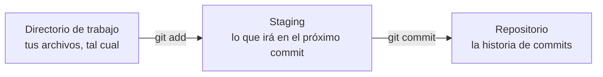

# Misión 1 · Tu primer repositorio

> **Laura:** Antes de tocar la documentación de la empresa, practica en un repositorio tuyo, desde cero. Vas a documentar el equipo en el que estás trabajando.

**Aprenderás:** qué es Git · `git init` · `git status` · `git add` · `git commit` · `git log` · `git diff` · `git rm`

---

## ¿Qué es Git?

¿Te suena esto?

```
trabajo.docx
trabajo_v2.docx
trabajo_v2_corregido.docx
trabajo_FINAL.docx
trabajo_FINAL_ahora_si.docx
trabajo_FINAL_ahora_si_de_verdad.docx
```

**Git** es un **sistema de control de versiones**: guarda la historia de tus archivos para que no tengas que hacer eso. Funciona como los **puntos de guardado de un videojuego**: cuando algo te sale bien, guardas; si después la lías, vuelves a un punto anterior.

Cada punto de guardado se llama **commit**. Un commit guarda cómo estaban tus archivos en ese momento y además **quién** lo hizo, **cuándo** y **por qué** (con un mensaje).

**¿Y para qué lo quiere un técnico de sistemas?** Para guardar scripts, archivos de configuración de routers y servidores, documentación... Cuando algo deja de funcionar, la primera pregunta siempre es *«¿qué ha cambiado?»*, y Git te lo dice.

> **Git no es lo mismo que GitHub.**
> - **Git** es el programa que has instalado. Funciona en tu ordenador, sin internet.
> - **GitHub** es una web donde se guardan copias de repositorios Git para compartirlas.
>
> Es como la diferencia entre el correo electrónico y Gmail.

Un **repositorio** es una carpeta cuyos cambios vigila Git.

## Las tres zonas de Git

Esto es lo más importante de la misión. Entenderlo te ahorrará muchos líos:



Piensa en una **foto de grupo**:

| Zona | En la foto de grupo | En Git |
|---|---|---|
| **Directorio de trabajo** | La gente que está por ahí | Tu carpeta, con los archivos como estén ahora mismo |
| **Staging** (zona de preparación) | Los que colocas delante de la cámara | Los cambios que eliges para el próximo commit (`git add`) |
| **Repositorio** | El álbum de fotos | Los commits ya guardados (`git commit`) |

¿Por qué no hacer la foto directamente? Porque así **eliges** qué entra. Si has cambiado 5 archivos pero solo 2 tienen que ver con lo mismo, haces un commit con esos 2 y otro con el resto.

---

## Paso a paso

### 1. Crea el repositorio

Abre Git Bash (Windows) o la terminal (Ubuntu):

```bash
cd ~/taller
mkdir mi-primer-repo
cd mi-primer-repo
git init
```

Git responde algo como `Initialized empty Git repository in .../mi-primer-repo/.git/`.

Se ha creado una carpeta oculta llamada `.git`, que es donde Git guarda toda la historia. Puedes verla con `ls -a`. **No toques nada de dentro.**

> **Importante:** `mi-primer-repo` tiene que estar en `~/taller/`, **al lado** de `taller-git`, no dentro. Compruébalo con `pwd`: debe salir algo que acabe en `/taller/mi-primer-repo`.

Ahora pregúntale a Git qué tal:

```bash
git status
```

```
On branch main

No commits yet

nothing to commit (create/copy files and use "git add" to track)
```

`git status` es tu mejor amigo: te dice dónde estás y qué está pasando. **Úsalo todo el rato**, antes y después de cada comando.

> Si tu Git está en español, verás los mismos mensajes traducidos («En la rama main», «No hay commits todavía»...). En el [glosario](glosario.md) tienes las equivalencias.

### 2. Crea tu primer archivo

Crea un archivo llamado `mi-equipo.md`. Puedes usar el editor que quieras:

```bash
code mi-equipo.md     # VS Code
nano mi-equipo.md     # nano (guardar: Ctrl+O y Enter · salir: Ctrl+X)
```

…o el Bloc de notas o el editor de texto de Ubuntu. Escribe esto dentro, **rellenándolo con los datos reales de tu equipo**:

```markdown
# Mi equipo

- **Nombre del equipo:**
- **Sistema operativo:**
- **Procesador:**
```

Cómo averiguar los datos (¡esto es de SMR!):

| Dato | Windows | Ubuntu |
|---|---|---|
| Nombre del equipo | `hostname` | `hostname` |
| Sistema operativo | Configuración → Sistema → Información | `lsb_release -d` |
| Procesador | Administrador de tareas → Rendimiento | `lscpu` |
| Memoria RAM | Administrador de tareas → Rendimiento | `free -h` |
| Disco | Explorador → Este equipo | `lsblk` o `df -h` |

Guarda el archivo y vuelve a preguntar:

```bash
git status
```

```
Untracked files:
  (use "git add <file>..." to include in what will be committed)
        mi-equipo.md
```

**Untracked** (en rojo) significa que Git ve el archivo pero **no lo está siguiendo**: todavía no forma parte de la historia.

### 3. Prepara y guarda: `add` + `commit`

Pon el archivo «delante de la cámara»:

```bash
git add mi-equipo.md
git status
```

```
Changes to be committed:
        new file:   mi-equipo.md
```

Ahora sale en verde: está en el **staging**. Haz la foto:

```bash
git commit -m "Añade la ficha de mi equipo"
```

**¡Tu primer commit!** La `-m` significa *message*: el mensaje que explica qué has hecho.

### 4. Mira la historia

```bash
git log
```

```
commit 3f2a9c1e8b7d6a5f4e3d2c1b0a9f8e7d6c5b4a3f (HEAD -> main)
Author: Lucía García <lucia@ejemplo.com>
Date:   Wed Oct 21 10:15:32 2026 +0200

    Añade la ficha de mi equipo
```

- La primera línea es el **identificador** del commit (*hash*): una ristra de números y letras que lo distingue de todos los demás.
- `Author` y `Date`: quién y cuándo.
- Debajo, el mensaje.

> **Consejo:** si `git log` (o cualquier comando) ocupa más que la pantalla, abajo aparece `:`. Muévete con las flechas y **pulsa `q` para salir**.

### 5. Modifica y vuelve a guardar

Añade estas líneas a `mi-equipo.md`, con tus datos:

```markdown
- **Memoria RAM:**
- **Disco:**
```

Guarda y mira qué opina Git:

```bash
git status
```

Ahora dice `modified: mi-equipo.md`. Para ver **exactamente** qué ha cambiado:

```bash
git diff
```

Las líneas que empiezan por `+` (en verde) son las que has añadido; las que empiezan por `-` (en rojo), las que has quitado. Guarda el cambio:

```bash
git add mi-equipo.md
git commit -m "Añade la RAM y el disco a la ficha"
```

> **Atajo:** `git add .` añade **todos** los cambios de la carpeta de golpe. Es cómodo, pero mira antes con `git status` qué vas a meter.

### 6. Borrar también es un cambio

Crea un archivo de prueba y guárdalo en un commit:

```bash
echo "esto es una prueba" > borrador.txt
git add borrador.txt
git commit -m "Añade un archivo de prueba"
```

Ahora bórralo **con Git**:

```bash
git rm borrador.txt
git status
git commit -m "Elimina el archivo de prueba"
```

El archivo ha desaparecido de tu carpeta... pero sigue en la historia: podrías recuperarlo cuando quisieras. Lo harás en la misión 3.

### 7. La historia completa

```bash
git log --oneline
```

```
b7e1d04 (HEAD -> main) Elimina el archivo de prueba
9c3f2a1 Añade un archivo de prueba
5d8e7f6 Añade la RAM y el disco a la ficha
3f2a9c1 Añade la ficha de mi equipo
```

Un commit por línea, del más reciente al más antiguo. Para referirte a un commit basta con los 7 primeros caracteres del identificador.

---

## Escribe buenos mensajes de commit

Dentro de seis meses, tú o un compañero leeréis esos mensajes para saber qué pasó. Escríbelos pensando en esa persona.

| Así no | Así sí |
|---|---|
| `cambios` | `Añade la RAM y el disco a la ficha` |
| `arreglo` | `Corrige el nombre del equipo` |
| `asdfg` | `Elimina el archivo de prueba` |
| `.` | `Actualiza el sistema operativo tras formatear` |

**Truco:** empieza por un verbo (*Añade*, *Corrige*, *Elimina*, *Actualiza*...) y di qué has hecho.

---

## Reto

Ahora sin ayuda, dentro de `mi-primer-repo`:

1. Crea un archivo `programas.md` con una lista de **al menos 5 programas** instalados en tu equipo y guárdalo en un commit.
2. Añade a `mi-equipo.md` una línea con la **dirección IP** de tu equipo (`ipconfig` en Windows, `ip a` en Ubuntu) y haz otro commit.
3. Comprueba con `git log --oneline` que tienes **al menos 5 commits** y con `git status` que no queda nada pendiente.

## Comprueba tu misión

El script de comprobación está en la carpeta del taller, así que vuelve allí:

```bash
cd ~/taller/taller-git
bash comprobar.sh 1
```

(El script busca tu repositorio en `~/taller/mi-primer-repo`.)

---

## Resumen

| Comando | Para qué sirve |
|---|---|
| `git init` | Convierte la carpeta actual en un repositorio |
| `git status` | Dice en qué estado está todo. **Úsalo siempre.** |
| `git add archivo` | Pasa los cambios del archivo al staging |
| `git add .` | Pasa al staging todos los cambios |
| `git commit -m "mensaje"` | Guarda lo que hay en el staging como un commit nuevo |
| `git log` / `git log --oneline` | Muestra la historia |
| `git diff` | Muestra los cambios que aún no están en el staging |
| `git rm archivo` | Borra un archivo y prepara ese borrado para el commit |

---

Anterior: [Misión 0](0-preparacion.md) · **Siguiente: [Misión 2 · Sube a la nube](2-sube-a-la-nube.md)**
