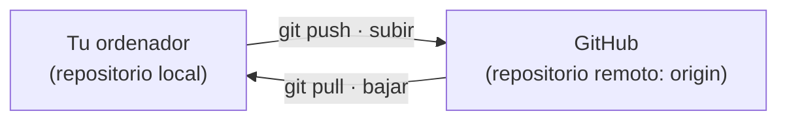
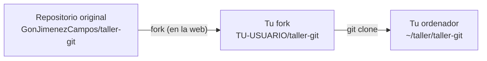

# Misión 2 · Sube a la nube

> **Laura:** Un repositorio que solo está en tu ordenador se pierde si se rompe el disco, y además nadie más puede verlo. Por eso usamos GitHub: una copia en la nube que compartimos todo el equipo.

**Aprenderás:** repositorio remoto · fork · `git clone` · `git remote` · `git push` · `git fetch` · `git pull` · Markdown

---

## Repositorio local y repositorio remoto

- **Local:** el que está en tu ordenador.
- **Remoto:** una copia en otro sitio, normalmente GitHub. El remoto principal se suele llamar **`origin`**.

Git **no los sincroniza solo**. Tú decides cuándo subir tus commits (`push`) y cuándo bajar los que haya nuevos (`pull`).



## ¿Qué hiciste en la misión 0?

Hiciste dos cosas sin saber muy bien qué eran:

1. **Fork:** copiar en GitHub el repositorio de otra persona a tu cuenta. Tu fork es tuyo: puedes cambiar lo que quieras sin afectar al original.
2. **Clone:** descargar un repositorio de GitHub a tu ordenador, **con toda su historia**.



Míralo tú:

```bash
cd ~/taller/taller-git
git remote -v
```

```
origin  https://github.com/TU-USUARIO/taller-git.git (fetch)
origin  https://github.com/TU-USUARIO/taller-git.git (push)
```

Tu repositorio local sabe que tiene un remoto llamado `origin` y dónde está. Ahora mira la historia:

```bash
git log --oneline
```

¡Hay un montón de commits! Es la historia de la documentación de Technova Solutions desde septiembre: al clonar te has traído **toda** la historia. La investigarás a fondo en la misión 3.

---

## Paso a paso

### 1. Date de alta como técnico/a

> **Laura:** Todo el personal del departamento tiene una ficha en `empresa/personal/`. Hazte la tuya.

1. Mira cómo son las fichas:
   ```bash
   ls empresa/personal/
   cat empresa/personal/LEEME.md
   cat empresa/personal/laura-martin.md
   ```
2. Crea tu ficha en `empresa/personal/` con el nombre **`TU-USUARIO.md`** (tu usuario de GitHub, en minúsculas), siguiendo la plantilla del `LEEME.md`.
3. Guárdala en un commit:
   ```bash
   git status
   git add empresa/personal/
   git commit -m "Añade la ficha de TU NOMBRE"
   ```
4. Súbela a GitHub:
   ```bash
   git push
   ```
   La primera vez te pedirá identificarte. En Windows se abre una ventana: elige **Sign in with your browser** y autoriza. En Ubuntu ya lo preparaste con `gh auth login`.

5. Abre tu fork en el navegador y entra en `empresa/personal/`: ¡ahí está tu ficha! Después vuelve a la portada de tu fork y pulsa el enlace **Commits** (con un reloj, arriba a la derecha de la lista de archivos): verás tu commit encima de los de Laura, Carlos, Ana y Javi.

### 2. Lo básico de Markdown

Los archivos `.md` están escritos en **Markdown**: texto normal con unos pocos símbolos que GitHub convierte en formato. Todo este taller está escrito así.

| Escribes | Se ve |
|---|---|
| `# Título` | Un título grande |
| `## Subtítulo` | Un título más pequeño |
| `**negrita**` | **negrita** |
| `*cursiva*` | *cursiva* |
| `- elemento` | • elemento (lista) |
| `1. elemento` | 1. elemento (lista numerada) |
| `[texto](https://github.com)` | [texto](https://github.com) |
| `` `comando` `` | `comando` |

Las tablas se hacen con `|` y guiones. Abre `empresa/inventario/equipos.md` con tu editor y compáralo con cómo se ve en GitHub.

### 3. Cambios hechos en GitHub

A veces un cambio se hace directamente en la web, o lo sube un compañero. Vamos a simularlo:

1. En tu fork, abre tu ficha (`empresa/personal/TU-USUARIO.md`) y pulsa el **lápiz** (*Edit this file*).
2. Añade una línea al final, por ejemplo: `- **Afición:** montar ordenadores`
3. Pulsa **Commit changes...** y otra vez **Commit changes**.

Ahora GitHub tiene un commit que tu ordenador **no tiene**. Pregúntale a Git:

```bash
git status
```

Dice `Your branch is up to date with 'origin/main'`. ¿Cómo que *up to date*? Es que `git status` compara con **lo último que sabe** de GitHub, y tu ordenador todavía no ha preguntado. Pregunta:

```bash
git fetch
git status
```

Ahora sí: `Your branch is behind 'origin/main' by 1 commit`. **`git fetch` mira qué hay nuevo en GitHub, pero no toca tus archivos.** Para traer los cambios:

```bash
git pull
```

Abre tu ficha: ahí está la línea nueva. Con `git log --oneline` verás también el commit hecho desde la web.

> **Consejo:** `git pull` = `git fetch` + aplicar los cambios.
>
> **Costumbre sana:** `git pull` al empezar a trabajar y `git push` al terminar.

### 4. Sube tu primer repositorio a GitHub

Tu `mi-primer-repo` de la misión 1 solo existe en tu ordenador. Vamos a subirlo:

1. En GitHub, botón **+** (arriba a la derecha) → **New repository**.
2. En *Repository name* escribe `mi-primer-repo`. Puede ser público o privado, como prefieras.
3. **No marques** *Add a README file*, ni *.gitignore*, ni licencia: el repositorio tiene que crearse **vacío**.
4. Pulsa **Create repository**. GitHub te enseña unas instrucciones; usa las del apartado **…or push an existing repository from the command line**:

```bash
cd ~/taller/mi-primer-repo
git remote add origin https://github.com/TU-USUARIO/mi-primer-repo.git
git branch -M main
git push -u origin main
```

| Comando | Qué hace |
|---|---|
| `git remote add origin URL` | «Este repositorio tiene un remoto llamado `origin` en esta dirección» |
| `git branch -M main` | Se asegura de que la rama se llame `main` |
| `git push -u origin main` | Sube la rama `main` a `origin`. El `-u` las deja enlazadas, así que a partir de ahora basta con `git push` |

5. Recarga la página de GitHub: ¡ahí están tus archivos y tus commits!

> **Consejo:** fíjate en las dos direcciones:
> - **De GitHub a tu PC:** `git clone`
> - **De tu PC a GitHub:** `git remote add` + `git push`

---

## Reto

1. En `mi-primer-repo`, crea **desde tu ordenador** un archivo `README.md` que explique qué es el repositorio. Usa al menos un título, una lista y una negrita. Haz commit y push.
2. En GitHub, edita ese `README.md` y añade un enlace a tu perfil (`https://github.com/TU-USUARIO`). Después baja el cambio a tu ordenador.
3. Vuelve a `~/taller/taller-git` y comprueba que todo está subido: `git status` debe decir *up to date* y *nothing to commit*.

## Comprueba tu misión

```bash
cd ~/taller/taller-git
bash comprobar.sh 2
```

---

## Resumen

| Comando | Para qué sirve |
|---|---|
| `git clone URL` | Descarga un repositorio de GitHub con toda su historia |
| `git remote -v` | Muestra los remotos del repositorio |
| `git remote add origin URL` | Conecta tu repositorio local con uno de GitHub |
| `git push` | Sube tus commits a GitHub |
| `git push -u origin main` | La primera subida de una rama |
| `git fetch` | Mira qué hay nuevo en GitHub, sin tocar tus archivos |
| `git pull` | Baja los cambios de GitHub y los aplica |

| En GitHub | Para qué sirve |
|---|---|
| **Fork** | Copiar el repositorio de otra persona a tu cuenta |
| **Lápiz** | Editar un archivo desde la web |
| **Commits** | Ver la historia del repositorio |

---

Anterior: [Misión 1](1-primer-repositorio.md) · **Siguiente: [Misión 3 · La máquina del tiempo](3-maquina-del-tiempo.md)**
