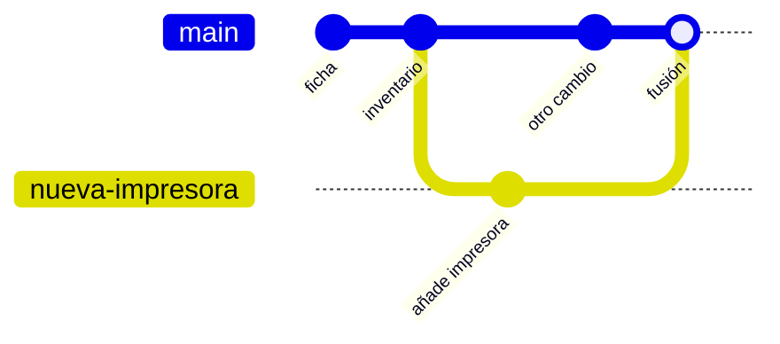

# Misión 4 · Universos paralelos

> **Laura:** En el departamento somos varios tocando los mismos archivos a la vez. Para no pisarnos, cada uno trabaja en su propia **rama** y, cuando termina, la **fusiona** con la principal. Ana y Javi han dejado trabajo pendiente en sus ramas. Te toca integrarlo.

**Aprenderás:** qué es una rama · `git branch` · `git switch` · `git merge` · resolver conflictos

---

## ¿Qué es una rama?

Hasta ahora todos tus commits iban uno detrás de otro, en la rama `main`. Una **rama** es una línea de trabajo paralela: puedes hacer commits en ella sin tocar `main`. Es como un **universo paralelo**: experimentas en él y, si sale bien, lo traes de vuelta a tu universo.



- **`main`** es la rama principal: la versión «oficial», la que funciona.
- **HEAD** significa «dónde estás ahora mismo».
- **Fusionar** (*merge*) es traer los cambios de una rama a otra.

Crear una rama no cuesta nada, así que en los equipos de verdad se usa una rama para cada cambio, por pequeño que sea.

---

## Parte 1 · Tu primera rama

```bash
cd ~/taller/taller-git
git switch main
git pull
git branch                       # lista tus ramas; el * marca dónde estás
git switch -c nueva-impresora    # crea la rama y te cambia a ella
git branch
```

Abre `empresa/inventario/impresoras.md` y añade una impresora **al final de la tabla**:

```markdown
| imp-almacen | Epson EcoTank ET-4850 | Almacén | WiFi | DHCP |
```

Guarda el cambio en un commit:

```bash
git add empresa/inventario/impresoras.md
git commit -m "Añade la impresora del almacén"
```

Y ahora, la magia:

```bash
git switch main
cat empresa/inventario/impresoras.md
```

¡La impresora no está! El cambio solo existe en la rama `nueva-impresora`. Compruébalo:

```bash
git switch nueva-impresora
cat empresa/inventario/impresoras.md
git switch main
```

Mira las dos líneas de trabajo dibujadas (sal con `q`):

```bash
git log --oneline --graph --all
```

Para **fusionar** te colocas en la rama que **recibe** los cambios y le dices qué rama traer:

```bash
git switch main
git merge nueva-impresora
```

Git responde `Fast-forward`. Como `main` no había cambiado desde que creaste la rama, Git simplemente «adelanta» `main` hasta donde estaba tu rama. Fácil.

---

## Parte 2 · La rama de Ana: `aula-2`

> **Laura:** Ana ha documentado los equipos de la nueva aula 2 en su rama `aula-2`. Revísala e intégrala en `main`.

Las ramas de tus compañeros vinieron con el fork. Para ver **todas** las ramas, también las de GitHub:

```bash
git branch -a
```

Tienen que salir `remotes/origin/aula-2` y `remotes/origin/servidor-impresion`.

<details>
<summary>No me salen esas ramas</summary>

Al hacer el fork no desmarcaste *Copy the `main` branch only*. No pasa nada: tráelas del repositorio original.

```bash
git remote add upstream https://github.com/GonJimenezCampos/taller-git.git
git fetch upstream
git branch -a
```

Ahora salen como `remotes/upstream/aula-2` y `remotes/upstream/servidor-impresion`. En los pasos de abajo, cambia:

- `git switch aula-2` → `git switch -c aula-2 upstream/aula-2`
- `git switch servidor-impresion` → `git switch -c servidor-impresion upstream/servidor-impresion`
- `main..origin/aula-2` → `main..upstream/aula-2`

Qué es `upstream` lo verás en la misión 5.
</details>

¿Qué ha hecho Ana? Mira sus commits:

```bash
git log --oneline main..origin/aula-2
```

`main..origin/aula-2` significa «los commits que están en `aula-2` pero no en `main`». Ahora entra en su rama y mira el inventario:

```bash
git switch aula-2
cat empresa/inventario/equipos.md
git switch main
```

(`git switch aula-2` crea en tu ordenador una rama `aula-2` que sigue a la de GitHub.)

Todo bien, así que fusiónala:

```bash
git merge aula-2
```

Esta vez **no** es fast-forward: `main` ha avanzado (tiene commits que Ana no tiene) y `aula-2` también. Git crea un **commit de fusión** (*merge commit*) que junta las dos líneas, y abre el editor con el mensaje `Merge branch 'aula-2'`. No cambies nada: guarda y cierra.

```bash
git log --oneline --graph
```

En el dibujo se ven dos líneas que se juntan.

---

## Parte 3 · La rama de Javi: ¡conflicto!

> **Laura:** Javi ha montado un servidor de impresión y lo ha documentado en su rama `servidor-impresion`. Intégrala también.

```bash
git switch servidor-impresion
git log --oneline -3
git switch main
git merge servidor-impresion
```

Uy:

```
Auto-merging empresa/red/direcciones-ip.md
CONFLICT (content): Merge conflict in empresa/red/direcciones-ip.md
Automatic merge failed; fix conflicts and then commit the result.
```

### ¿Qué es un conflicto?

Javi (en su rama) y Carlos (en `main`) han cambiado **la misma parte del mismo archivo**. Git no sabe con qué quedarse, así que te lo pregunta a ti. **No es un error**: es normal y pasa constantemente en cualquier equipo.

```bash
git status
```

Dice `both modified: empresa/red/direcciones-ip.md`. Abre ese archivo con tu editor. Al final de la tabla verás esto:

```
| 192.168.10.32 | imp-direccion | Impresora de dirección | Ana |
<<<<<<< HEAD
| 192.168.10.50 | portatil-direccion | Portátil de dirección | Carlos |
=======
| 192.168.10.50 | srv-impresion | Servidor de impresión (CUPS) | Javi |
>>>>>>> servidor-impresion
```

| Marca | Significado |
|---|---|
| `<<<<<<< HEAD` | Aquí empieza lo que hay en **tu** rama (`main`) |
| `=======` | Separa las dos versiones |
| `>>>>>>> servidor-impresion` | Aquí acaba lo que viene de la **otra** rama |

**Míralo bien:** ¡Carlos y Javi han reservado **la misma IP** (la `.50`) para dos dispositivos distintos! Si dejaras las dos líneas tal cual, en la red de verdad el portátil y el servidor tendrían un **conflicto de IP** y fallarían los dos.

### Cómo resolverlo

1. Edita el archivo y déjalo **como tiene que quedar**:
   - con **los dos** dispositivos,
   - cada uno con **una IP distinta**: dale al servidor una IP libre (por ejemplo, la `.51`),
   - **sin** las líneas `<<<<<<<`, `=======` y `>>>>>>>`.
2. **Ojo:** Javi también escribió la IP del servidor en `empresa/red/servidor-impresion.md` (varias veces). Si le has cambiado la IP al servidor, **cámbiala también ahí**. Resolver un conflicto no es solo quitar las marcas: es dejarlo todo coherente.
3. Guarda los archivos y dile a Git que el conflicto está resuelto:
   ```bash
   git add empresa/red/direcciones-ip.md empresa/red/servidor-impresion.md
   git status
   ```
4. Termina la fusión con un commit. Al no poner `-m`, se abre el editor con el mensaje de fusión ya escrito: guarda y cierra.
   ```bash
   git commit
   ```

> **En VS Code** los conflictos salen de colores, con unos botones encima: *Accept Current Change* (lo tuyo), *Accept Incoming Change* (lo de la otra rama) y *Accept Both Changes* (las dos cosas). Aquí te conviene *Accept Both Changes* y después cambiar una IP a mano.

> **Si te lías:** `git merge --abort` cancela la fusión y lo deja todo como estaba antes del `git merge`. Puedes volver a intentarlo.

---

## Parte 4 · Sube todo

```bash
git push
```

Si quieres, sube también tu rama para verla en GitHub (en el desplegable de ramas, arriba a la izquierda):

```bash
git push -u origin nueva-impresora
```

---

## Reto: provoca tu propio conflicto

1. Desde `main`, crea una rama `prueba-a`. Cambia en tu ficha (`empresa/personal/TU-USUARIO.md`) la línea del **puesto** y haz commit.
2. Vuelve a `main`, crea otra rama `prueba-b` y cambia **la misma línea** de otra manera. Haz commit.
3. Vuelve a `main` y fusiona `prueba-a` (será fast-forward). Luego fusiona `prueba-b`: tendrás un conflicto. Resuélvelo.
4. Borra las ramas que ya están fusionadas: `git branch -d prueba-a prueba-b`
5. Sube los cambios con `git push`.

## Comprueba tu misión

```bash
bash comprobar.sh 4
```

---

## Resumen

| Comando | Para qué sirve |
|---|---|
| `git branch` | Lista tus ramas (el `*` marca dónde estás) |
| `git branch -a` | Lista también las ramas de GitHub |
| `git switch -c nombre` | Crea una rama y te cambia a ella |
| `git switch nombre` | Te cambia a otra rama |
| `git merge nombre` | Trae a tu rama actual los cambios de la rama `nombre` |
| `git merge --abort` | Cancela una fusión con conflictos |
| `git log --oneline --graph --all` | Dibuja todas las ramas |
| `git log main..otra` | Commits que están en `otra` pero no en `main` |
| `git branch -d nombre` | Borra una rama que ya está fusionada |

**Para resolver un conflicto:** editar el archivo (quitar marcas y dejarlo bien) → `git add` → `git commit`.

---

Anterior: [Misión 3](3-maquina-del-tiempo.md) · **Siguiente: [Misión 5 · Trabajo en equipo](5-trabajo-en-equipo.md)**
