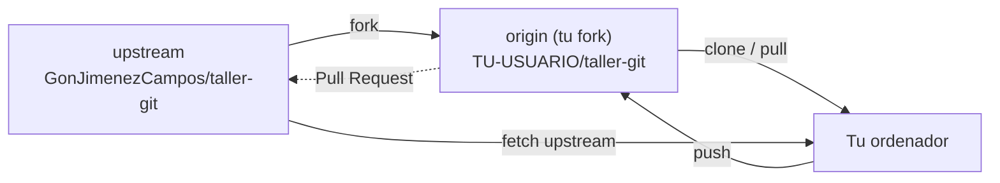

# Misión 5 · Trabajo en equipo

> **Laura:** Hasta ahora has trabajado en tu copia. Pero en un equipo de verdad los cambios tienen que llegar al repositorio **común**, y antes alguien los revisa. En GitHub eso se hace con **Pull Requests**. Vas a presentarte al resto de la clase mandando una al repositorio original.

**Aprenderás:** `upstream` · Issues · Pull Requests · revisar cambios · mantener tu fork al día

---

## Ideas clave

- **Issue:** una incidencia o tarea apuntada en GitHub. Es como un **ticket de soporte**: alguien describe un problema o algo que hay que hacer, se comenta, se asigna a alguien y se cierra cuando está resuelto.
- **Pull Request (PR):** una «solicitud de fusión». Es decirle al dueño de un repositorio: *«He hecho estos cambios en mi rama, ¿los fusionas en la tuya?»*. El dueño los revisa, comenta, pide cambios si hace falta y, cuando le parecen bien, los acepta (*merge*).
- **upstream:** el nombre que se le suele dar al repositorio **original**, del que hiciste el fork. (`origin` es tu fork.)



No puedes hacer `push` al repositorio del profe porque no es tuyo. Lo que sí puedes es **proponerle** cambios con una Pull Request.

---

## Parte 1 · Conecta con el original

```bash
cd ~/taller/taller-git
git switch main
git remote add upstream https://github.com/GonJimenezCampos/taller-git.git
git remote -v
git fetch upstream
```

Ahora tu repositorio local conoce dos remotos: `origin` (tu fork) y `upstream` (el original).

> Si ya añadiste `upstream` en la misión 4, Git dirá `error: remote upstream already exists`. No pasa nada, sigue.

## Parte 2 · Abre una issue

1. Ve al repositorio original: [github.com/GonJimenezCampos/taller-git](https://github.com/GonJimenezCampos/taller-git)
2. Pestaña **Issues** → **New issue**.
3. **Título:** `Alta en la clase: TU NOMBRE`
   **Descripción:** `Quiero añadir mi presentación a la carpeta clase/.`
4. Pulsa **Create**. GitHub le pone un número (por ejemplo, `#12`). **Apúntalo.**

## Parte 3 · Prepara tu cambio en una rama nueva

**Importante:** la rama tiene que salir de **`upstream/main`** (el original), **no de tu `main`**. Tu `main` tiene todos los experimentos de las misiones anteriores y, si la usaras, ¡tu Pull Request se los llevaría todos!

```bash
git switch -c alta-TU-USUARIO upstream/main
```

Crea tu presentación copiando la plantilla:

```bash
cp clase/PLANTILLA.md clase/TU-USUARIO.md
```

Rellénala con tu editor. Después, haz commit y sube **la rama** a tu fork.

> **Importante:** si haces `git status` verás que aparece `secreto.txt` (y también `prueba.log` y `copias/`, si hiciste el reto de la misión 3). Es porque esta rama viene del original, que no tiene tu `.gitignore`. **No lo añadas:** usa `git add clase/TU-USUARIO.md` y no `git add .`

```bash
git add clase/TU-USUARIO.md
git commit -m "Añade la presentación de TU NOMBRE"
git push -u origin alta-TU-USUARIO
```

## Parte 4 · Abre la Pull Request

1. Ve a tu fork en GitHub. Saldrá un aviso amarillo: *alta-TU-USUARIO had recent pushes*. Pulsa **Compare & pull request**.
   (Si no sale: pestaña **Pull requests** → **New pull request** → enlace **compare across forks**.)
2. Revisa la barra de arriba. Tiene que quedar así:

   **base repository:** `GonJimenezCampos/taller-git` · **base:** `main` ← **head repository:** `TU-USUARIO/taller-git` · **compare:** `alta-TU-USUARIO`

   Más abajo, en los cambios, tiene que aparecer **solo tu archivo**.
3. **Título:** `Añade la presentación de TU NOMBRE`. En la descripción escribe (con el número de tu issue):
   ```
   Closes #12
   ```
   Así, cuando acepten la PR, la issue se cerrará sola.
4. Pulsa **Create pull request**.

## Parte 5 · La revisión

En un equipo de verdad nadie fusiona nada sin que otra persona lo revise antes.

- **Si el profe te pide cambios** (te llegará una notificación y lo verás en la PR): edita el archivo en tu ordenador, haz commit **en la misma rama** y `git push`. La PR se actualiza sola, ¡no hace falta abrir otra!
  ```bash
  git switch alta-TU-USUARIO
  # ...editas el archivo...
  git add clase/TU-USUARIO.md
  git commit -m "Corrige la presentación según la revisión"
  git push
  ```
- **Revisa la PR de alguien:** en el repositorio original → **Pull requests** → elige una de un compañero → pestaña **Files changed**. Pasa el ratón por una línea, pulsa el **+** azul que aparece y deja un comentario: algo útil y con buen tono. Luego pulsa **Review changes** → **Comment** → **Submit review**.

Cuando el profe acepte tu PR, se pondrá en morado (**Merged**) y tu issue se cerrará sola. Compruébalo.

## Parte 6 · Pon tu fork al día

El original ha cambiado (ahora tiene las presentaciones de toda la clase) y tu fork se ha quedado atrás. Hay dos formas de ponerlo al día:

- **Desde la web:** en tu fork, botón **Sync fork** → **Update branch**. Después, en tu ordenador:
  ```bash
  git switch main
  git pull
  ```
- **Desde la terminal:**
  ```bash
  git switch main
  git fetch upstream
  git merge upstream/main
  git push
  ```
  Con `git merge` se abrirá el editor con el mensaje de fusión: guarda y cierra.

Ahora `ls clase/` te enseña las presentaciones de tus compañeros.

---

## Reto

1. Busca en la PR de un compañero una errata o algo mejorable y déjale un comentario en la línea exacta.
2. Contesta a los comentarios que te hayan dejado en tu PR.
3. Abre una issue en el repositorio original proponiendo una mejora para este taller (¿qué explicarías de otra forma?).

## Comprueba tu misión

```bash
git switch main
bash comprobar.sh 5
```

Si tu PR todavía no está aceptada, el script te lo dirá con un `[AVISO]`. Es normal: no tienes que esperar para empezar la misión 6.

---

## Resumen

| Comando | Para qué sirve |
|---|---|
| `git remote add upstream URL` | Conecta tu repositorio con el original |
| `git fetch upstream` | Mira qué hay nuevo en el original |
| `git switch -c rama upstream/main` | Crea una rama a partir del original |
| `git push -u origin rama` | Sube una rama a tu fork |
| `git merge upstream/main` | Trae a tu rama los cambios del original |

| En GitHub | Para qué sirve |
|---|---|
| **Issue** | Apuntar un problema o una tarea (un ticket) |
| **Pull Request** | Proponer que fusionen tus cambios |
| **Closes #N** | En una PR: cierra la issue N cuando se acepte |
| **Files changed** | Ver y comentar los cambios de una PR |
| **Sync fork** | Poner tu fork al día con el original |

---

Anterior: [Misión 4](4-universos-paralelos.md) · **Siguiente: [Misión 6 · Misión final](6-mision-final.md)**
